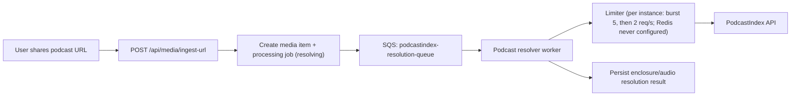

# PodcastIndex Rate Limiting Architecture (Share-Only)

## Status
- Accepted (implemented for task-9 scope)
- Last updated: 2026-11-08 — the limit this ADR was built on was measured and found
  to be wrong; see "Measured limit". The queue-first design stands, the 1 req/s
  premise does not.

## Decision context (updated)

This ADR supersedes the previous legacy assumption of two distinct traffic families
(`manual podcast search` vs `async playlist sync`).

Current product architecture is now:
- no Spotify playlist sync
- no end-user manual podcast search flow as a product requirement
- a single entry path for podcasts: user shares a podcast URL into the app, then ingestion resolves to `enclosureUrl` through PodcastIndex

The constraint this ADR assumed, and which turned out to be false:
- ~~PodcastIndex enforces a strict global limit of `1 request / second` per API key.~~
  PodcastIndex documents no rate limit at all, and the measured limit is per client IP,
  between 64 and 128 requests per second (next section). `1 req/s` is a policy of this
  application, not a constraint of the provider.

## Measured limit (2026-11-08)

What the provider says: the API documentation
(<https://podcastindex-org.github.io/docs-api/>, source in
`Podcastindex-org/docs-api`) publishes no rate limit; it caps `max` at 1000 per call.
Responses carry no rate-limit header (`X-RateLimit-*`, `Retry-After`) under normal use.

What was measured, from one machine, with this application's key, on
`GET /podcasts/byfeedid`, in 10–15 s steps with a 1 req/s probe against another
Cloudflare host as a network control:

| Rate sent | Requests | Result |
|---|---|---|
| 2 – 16 req/s | 450 | all `200`, median ~140 ms, p95 < 175 ms |
| 32 req/s for 10 s | 320 | all `200` |
| 64 req/s for 10 s | 640 | all `200`, p95 202 ms |
| 128 req/s | ~250 in 2 s | `429`, `Retry-After: 3600` |

The `429` is Cloudflare's, in front of the API: `Error 1015: You are being rate limited
by the website owner's configuration`. An unauthenticated request from the same machine
got the same `429` and the same countdown, so the block is **per client IP, not per
key**: the key, which dev and prod share, was not banned. The penalty is a full hour.

Two earlier runs the same evening showed a slow tail at 8–16 req/s (p95 ~1 s, a few
requests with no answer after 20 s) with the network control clean. A third run at the
same rates was spotless. That slowness is PodcastIndex's own variance, not a response
to our rate; the code already treats a timeout as transient.

Not measured: a window longer than 15 s. A Cloudflare rule can also count per minute or
per hour, so sustained traffic far below 64 req/s for a long time is not proven safe.
The exact threshold between 64 and 128 req/s was not sought: finding it costs another
hour-long block.

### What bounds our rate today

Only `podcastindex_resolution_worker` calls PodcastIndex in production (Spotify, Apple
Podcasts, Deezer resolvers). Its global rate is a product of settings, not a function
of the number of users — more shares make the SQS queue longer, never the outbound
rate higher. Each instance runs a GCRA pacer: `PODCASTINDEX_RATE_LIMIT_BURST` calls at
once, then `PODCASTINDEX_RATE_LIMIT_RPS` per second (defaults 5 and 2, since
2026-11-08; before, 1 req/s with no burst, which made every resolution wait a second
between its 3 to 7 calls):

    sustained: instances (ESM maximum_concurrency, 10) × RPS (2)   = 20 req/s
    at once:   instances (10)                          × BURST (5) = 50 requests

**Keep both well under 64.** Raising `maximum_concurrency`, `PODCASTINDEX_RATE_LIMIT_RPS`
or `PODCASTINDEX_RATE_LIMIT_BURST`, or disabling the limiter, moves them; nothing else
in the code warns about it. `batch_size` is 1, so an instance resolves one episode at
a time. Lambda egress IPs are AWS's, shared with other customers, and
instances do not necessarily share one, so the per-IP margin is likely wider than this
product suggests — and a neighbour on the same IP could trip the block for us.

The Redis limiter described below was never configured: no environment sets
`PODCASTINDEX_LIMITER_REDIS_URL`, so each Lambda instance paces itself locally and the
"global 1 req/s" below is in practice the per-instance pace above. Making it global is part of
the provider capacity work (TASK-563 / TASK-564, deferred by owner decision of
2026-10-29), not of this ADR.

A `429` from Cloudflare asks for an hour. The resolver retries a few seconds later and
SQS redelivers up to three times, so jobs reaching PodcastIndex during a block fail
rather than wait it out.

## Problem

Without a global coordinator, concurrent requests from multiple API instances/workers can:
- breach PodcastIndex quota
- generate `429` errors
- create unstable UX and retries

Goal:
- absorb bursts safely
- avoid user-visible `429`
- keep behavior deterministic in multi-instance deployments

## Options considered in the new context

### Option A - Distributed Redis limiter only (inline calls)
- Principle: every PodcastIndex call acquires a global slot in Redis (atomic), then calls PodcastIndex.
- Pros:
  - simple conceptual model
  - multi-instance safe if implemented correctly
  - minimal extra infra beyond Redis
- Cons:
  - request-path latency grows directly under burst
  - API workers may spend time waiting/sleeping
  - harder backpressure control compared to a queue

### Option B - Dedicated PodcastIndex queue + worker + Redis hard guard
- Principle:
  - enqueue PodcastIndex resolution work
  - dedicated worker consumes queue
  - worker enforces global `1 req/s` via Redis limiter before each external call
- Pros:
  - true backpressure: bursts stay in queue, not in API threads
  - stable user path (`ingest-url` returns quickly, processing continues)
  - clean operational controls (DLQ, retries, queue depth alarms)
  - multi-instance safe with Redis hard guard
- Cons:
  - extra moving parts (queue + worker + observability)
  - eventual consistency (resolution is asynchronous by design)

### Option C - Per-instance local sleep limiter
- Principle: each instance sleeps locally between calls.
- Verdict: rejected.
- Reason: not safe in multi-instance, cannot enforce global quota.

## Recommended decision

Recommendation: **Option B** with **single API key** (no manual/async split).

Why:
- the product is now share-first and inherently async for media processing
- queue-first architecture gives better burst handling and protects API latency
- Redis limiter still guarantees strict global rate compliance across workers/instances

## Detailed rationale: why Option B over Option A

Decision drivers for current product constraints:

1. API responsiveness on share intake (`POST /api/media/ingest-url`)
- Option A (inline limiter): API path can be blocked waiting for limiter slots during bursts.
- Option B (queue-first): API returns quickly after enqueue; waiting happens off-request in workers.
- Impact: Option B preserves a predictable intake UX under concurrent shares.

2. Backpressure behavior under bursts
- Option A: pressure accumulates in API instances (pending requests, long response times, possible timeouts).
- Option B: pressure accumulates in queue depth, which is explicit and controllable.
- Impact: Option B gives a safer failure mode and better burst absorption.

3. Multi-instance operational determinism
- Option A: correct but sensitive to request-time waiting, cancellation, and retry complexity in API tier.
- Option B: single consumption path for PodcastIndex calls, with Redis as hard global guard.
- Impact: Option B is easier to reason about and operate at scale.

4. Reliability controls and recovery
- Option A: retries and retry storms can affect live API capacity.
- Option B: retries are isolated in worker pipeline with DLQ, bounded retries, and replay patterns.
- Impact: Option B reduces blast radius of upstream instability (`429`/timeout/`5xx`).

5. Observability and SLO management
- Option A: bottlenecks show as API latency spikes, mixed with other causes.
- Option B: queue metrics (depth/age), worker metrics, and limiter wait are explicit signals.
- Impact: Option B improves diagnosability and incident response.

6. Infrastructure and complexity trade-off
- Option A: lower infra footprint.
- Option B: adds queue + worker + DLQ and monitoring.
- Impact: we accept extra complexity because it buys predictable UX and stronger operational safety for share bursts.

Summary:
- Option A is viable for low traffic and minimal infrastructure.
- Option B is preferred for production-grade share-first behavior, where controlled latency and stable throughput are more important than minimal infra.

## Target architecture

Key points:
- no `manual vs async` key split
- all PodcastIndex calls pass through one governed pipeline
- Redis limiter was meant as the hard global guardrail; it is not configured (see "What bounds our rate today")

## Runtime behavior and error policy

- `POST /api/media/ingest-url` must not block on PodcastIndex quota wait.
- Under burst, work queues and progresses through status polling (`GET /api/media/{media_item_id}`).
- If PodcastIndex returns transient failures (`429`, timeout, `5xx`):
  - retry with bounded exponential backoff + jitter
  - keep failure details internal/logged
  - expose stable user-safe states (`resolving` -> `failed` with canonical error code)
- No stack traces or provider internals in client-facing messages.

## Configuration and deployment impact

Required:
- `PODCASTINDEXORG_API_KEY`
- `PODCASTINDEXORG_API_SECRET`
- `PODCASTINDEX_RATE_LIMIT_RPS` (default 2) and `PODCASTINDEX_RATE_LIMIT_BURST` (default 5), per instance while Redis is not configured
- `PODCASTINDEX_LIMITER_REDIS_URL` (optional; unset in every environment as of 2026-11-08)
- `PODCASTINDEX_RESOLUTION_QUEUE` (new)
- `PODCASTINDEX_RESOLUTION_DLQ` (new)
- `PODCASTINDEX_MAX_RETRIES` (bounded retries)

Operational:
- provision queue + DLQ
- run resolver worker service
- add alarms on queue depth, queue age, worker failures, and 429 rate

## Observability requirements

Track at minimum:
- PodcastIndex calls total/success/failure/429
- limiter wait time (p50/p95/p99)
- queue depth and oldest message age
- resolution latency end-to-end
- retry count and terminal failure rate

Structured logs should include:
- `media_item_id`
- `media_key`
- `source_platform`
- attempt number
- limiter wait duration

## Reproducible multi-instance validation

Validation scenario:
1. Start at least 2 resolver worker instances.
2. Inject a burst of N podcast resolution jobs quickly (e.g., 50).
3. Verify global outbound call cadence to PodcastIndex stays <= 1 req/s.
4. Verify no user-visible 429 surfaced in API responses.
5. Verify queue drains and jobs complete/fail deterministically.

Practical local check for the limiter itself:
- `PODCASTINDEX_LIMITER_REDIS_URL=redis://localhost:6379/0 python scripts/verify_podcastindex_limiter_multi_instance.py --workers 4 --iterations 5`
- Expected result: any n consecutive slots, across processes, span at least (n - burst) intervals.

Success criteria:
- global rate compliance proven by logs/metrics timestamps
- stable processing under burst
- no quota breach side effects for users

## Implementation status (task-9)

Implemented in this repository:
- queue-first routing for podcast resolution jobs (`podcastindex-resolution-queue`)
- dedicated worker (`podcastindex_resolution_worker`) forwarding successful resolutions to `deepgram-transcription-queue`
- Redis-backed global limiter integrated in `podcast_index.py` calls with local fallback for dev resilience
- env/config scaffolding for limiter and queue settings

Current scope:
- RSS-like feed URL resolution path is implemented in this task
- Spotify/Apple/Deezer-specific resolution logic is intentionally left to dedicated resolver tasks (`task-25`, `task-26`, `task-27`)

## Explicit decision checkpoint (to confirm together)

To finalize task-9, confirm the following:
1. We adopt **queue-first resolution** (Option B) as the default for all PodcastIndex calls. ✅ Confirmed on 2026-02-24
2. We keep **single PodcastIndex key pair** (no manual/async split). ✅ Implemented in task-9
3. We enforce `1 req/s` with **Redis global limiter** as mandatory hard guard. ✅ Implemented in task-9
